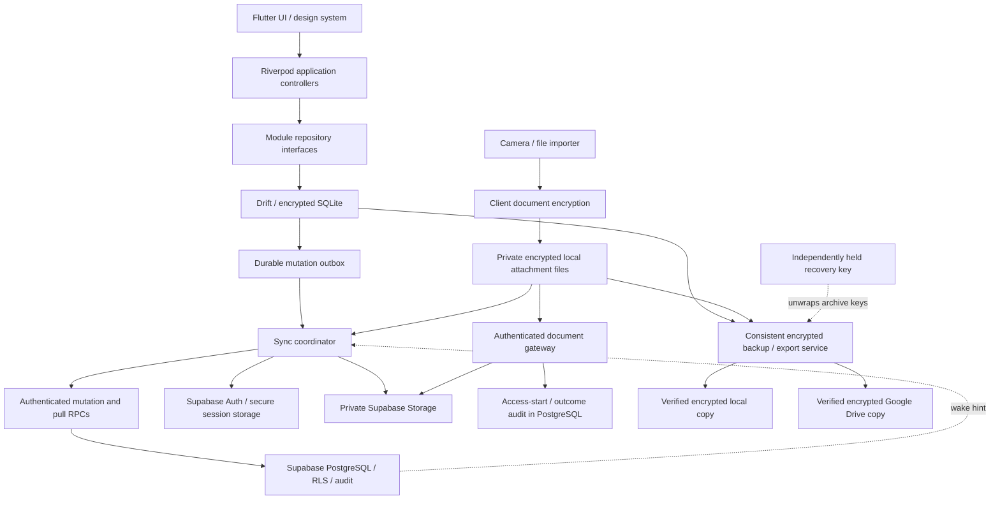

# System architecture — proposal

Product authority: [ADR 0003](decisions/0003-confirmed-product-architecture.md).
INR/paise, shared family finance/documents and both backup destinations are
confirmed. This revised technical architecture remains pending review.

The local encrypted database is the mobile read model. Supabase PostgreSQL is the
authoritative shared store. Sync reconciles them; Realtime only prompts a pull.
There is no Google Drive live-sync dependency.

## Module boundaries

| Boundary | Owns | Allowed dependencies |
| --- | --- | --- |
| Core | Configuration, typed errors, clock/IDs, secure storage, key access, database execution | Platform APIs and reviewed infrastructure packages |
| Identity/access | Independent auth accounts, admin/member roles, local unlock, enrollment, bound sessions, revocation | Core and server access adapter |
| Sync | Outbox, cursor, replay receipts, conflicts, attachment lifecycle | Core, access policy, typed module serializers |
| Family finance | Accounts, journal, budgets, savings/report projections | Core and sync contracts; exposes journal service |
| Wealth | Asset records, ownership and valuation observations | Core; journal links through application services |
| Liabilities | Contracts, approved schedules and repayments | Core; journal service for settlement |
| Business | Business scope, expenses/revenue, payroll records, inventory movement | Core, journal service; future billing adapter boundary only |
| Document vault | Shared family visibility, ownership metadata, immutable versions, access audit, device key envelopes | Core, access, sync, authenticated gateway and private storage adapter |
| Analytics | Permission-filtered projections of authorized module records | Read-only module query contracts, FL Chart presentation |
| Backup/export | Snapshot manifests, archive encryption, independent local/Drive receipts, recovery validation | Core, module export contracts and separately authorized Drive adapter |

Avoid direct module-to-module table writes. Use application services to coordinate
cross-module transactions. Derived dashboards have no independent editable totals.
The future billing module receives no schema/workflow in this phase.

## Mobile layout

`lib/app/` owns theme/router/app lifecycle; `lib/core/` owns infrastructure;
`lib/features/auth/` owns the session boundary; later modules get their own
`domain/`, `application/`, `data/`, `presentation/` only as they are implemented.
Do not build empty classes/folders for every future feature.

Riverpod injects repositories and owns disposal; GoRouter enforces presentation
gates. Neither is an authorization boundary. RLS and mutation RPCs independently
authorize requests. Unknown/expired permissions fail closed.

Shared records have no creator-only edit gate. Every authorized member can create
and edit shared financial data and access shared documents. Preserve the creator,
set modifier identity from the verified caller and append immutable audit. A
document's owner can differ from its uploader and cannot restrict family access.
Posted financial history is corrected through linked events; deletion is soft.
Use exact integer paise for INR and `en_IN`/₹ presentation; currency catalogs remain
extensible. No monetary computation or exact formatting passes through a double.

## Authentication and local unlock

Supabase Auth handles online identity. Store refresh/session data only in secure
platform storage. Disable implicit deep-link handling until exact verified links
and redirect allowlists are configured. No open registration; members are invited
by a trusted administrator through a server-only control plane.

Proposed device enrollment requires an authenticated member's proof of private-key
possession and administrator approval of the bound public-key identity. The
server binds the verified Auth session to the approved device; arbitrary device
headers are insufficient. Membership/session/device revocation is checked on
backend requests. Sensitive administration is separate from ordinary collaboration.
Historical document key backfill follows enrollment so every member can open the
shared history without an owner-specific grant or shared private key.

Authentication, local unlock and authorization are separate states. On startup,
background, timeout and account change, close protected repositories and release
keys. A cached JWT alone does not unlock a cache. Production offline unlock needs
a previously authorized device, OS-backed key access and an approved lease policy.
Revoked/offline devices cannot be remotely erased instantly; communicate this limit.

Use separate encrypted database/files/key namespace per `(user, family, device)`;
never reuse a prior account's singleton database. Logout revokes tokens and clears
local credentials; user-visible pending-operation handling must precede destruction
of the only recoverable offline copy. Until that flow exists, protected data
features remain disabled.

## Implementation boundary of Phase 3

Only an app shell, theme/navigation, auth adapter boundary, encrypted local sync
metadata tables and tests may be implemented. The running shell must not create
family members, collect financial data, assume a working backend, unlock a real
vault or present fake financial reports. Full sync, document crypto/key exchange,
offline unlock and feature migrations remain later milestones after review.

## Backend execution

Typed security-invoker RPCs are preferred. Any required security-definer helper
has a fixed empty search path, qualified identifiers, minimal owner privileges,
explicit caller checks and restricted EXECUTE grants. Use database membership
state, not editable JWT user metadata, for current roles. Server time/revision,
mutation receipts, audit events and change-feed events commit atomically.
No administrative credentials enter Flutter. No cloud resources are created here.

The proposed document gateway performs authenticated per-request checks and
durable access-start audit before streaming ciphertext, then appends completion
or failure. Deny direct unaudited Storage reads/client URL signing. Offline cache
opens are device reports, not server-proven views. See the permission/threat docs
for assurance limits; this gateway is not implemented.

The gateway resolves an opaque version ID to its authorized server-owned object
path; it never proxies an arbitrary client-supplied path or URL. Prefer a narrowly
scoped server capability. If Storage requires a service-role credential, isolate
it behind this authorization/audit boundary: it bypasses RLS and cannot protect
itself from a compromised or incorrectly implemented gateway. Transfer completion
records server streaming outcome, not proof that a human viewed the plaintext.

Backups require both local and Drive adapters. Freeze one consistent authenticated
archive, then verify/acknowledge each destination independently. Schedules are
best-effort under mobile OS limits; report deferred work. Restore must work on a
clean device with an independently held recovery key and current enrollment for
live access. Neither adapter nor a clean-device restore is implemented yet.
