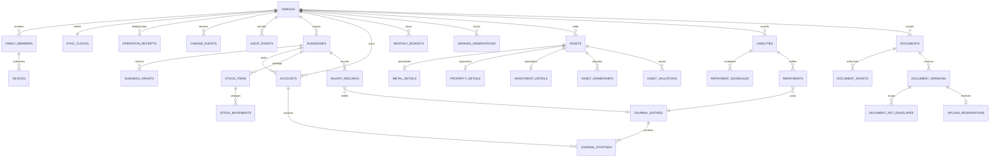

# Database design — proposal awaiting review

`design/postgresql.sql` is a review model in an isolated schema with deny-all
RLS and no client grants, **not an application backend or migration**. It models
requested modules; invariant triggers, authorized RPCs and read policies are
explicitly deferred. Do not place it in `supabase/migrations/` or deploy it.
`design/sqlite.sql` models the Phase 3 local infrastructure tables. Financial
SQLite mirrors will be added only after review using Drift schema migrations.

## ER overview

Every domain relationship uses a composite `(family_id, id)` foreign key.
Business/account, liability/journal and document/version associations cannot
cross families. No real records or sample family identities are inserted.

## Common types and metadata

- Cloud `uuid`; local lowercase UUID strings generated once with CSPRNG UUIDv4.
- Cloud `bigint` revision, nonnegative locally. Server assigns revisions and
  authoritative UTC times; client clocks never choose a conflict winner.
- `created_at`, `updated_at`, nullable `deleted_at`, `created_by` and `revision`
  on mutable entities. Actor comes from verified auth context. Local timestamps
  are integer Unix microseconds; accounting `date` remains a calendar date.
- Money is signed integer minor units plus a currency FK and explicit scale from
  a currency catalog. Do not combine currencies or infer conversion rates. Check
  bounds before arithmetic; cloud/SQLite signed 64-bit overflow must fail safely.
- Metal weight is integer milligrams, purity parts per million; ownership is
  proposed basis points. Investment quantities use integer plus scale. Precision
  choices require review; no float-based accounting or measurements.
- No Aadhaar/PAN numbers or document contents as searchable plain database fields.
  Encrypt sensitive descriptive metadata; approved local search indexes remain
  inside the encrypted vault. Document categories are neutral classifications.

## Financial modeling decisions for review

A journal and postings are proposed so a bank/cash transfer is one balanced
aggregate, rather than two unrelated income/expense records. Accounts distinguish
bank/cash and accounting categories. A posted journal balances independently per
currency and business/family scope; posted entries become immutable and corrections
reference reversals. Account totals are derived, never independently authoritative.
Simple income/expense UI can map to this model after the chart/accounting review.

Monthly budgets reference an account/category and a currency. Savings observations
are explicit dated records; automatic savings formulas and target workflows are
not inferred. Valuations retain source/date/currency and never silently replace
purchase cost. Current value means the latest authorized eligible observation,
with a visible as-of date and missing-value state. Asset ownership aggregation
must avoid counting the same family asset once for every owner.

Liabilities distinguish borrowed from lent, original principal, currency and
versioned terms. Interest method/day-count/rounding are intentionally unspecified
until review. Schedules and actual repayments are separate; repayments link to a
journal aggregate, principal and interest components. Do not implement balance
formulas or EMI logic from these placeholders alone.

Business income/purchases/expenses flow through scoped journal entries; salaries
and stock movements retain history. Costing method and cash-vs-accrual P&L remain
open. There are no billing, tax or invoice tables. Vehicles and other valuables
use the common asset model with reviewed extension data later.

## Invariants required before executable financial migrations

The proposal supplies field checks, uniqueness and tenant-safe references; the
following cross-row rules require tested triggers/RPCs and are **not implemented**
by this schema alone:

1. Balanced posted journals, at least two valid postings, one allowed scope,
   currency compatibility with accounts, immutability and linked reversals.
2. Sum of asset ownership does not exceed 100%; same owner uniqueness; ownership
   intervals/history semantics and totals validated transactionally.
3. Liability repayment components, schedule/terms policy, overpayment handling and
   outstanding balances under concurrent operations.
4. Stock quantity/cost rules, allowed negative stock policy and salary settlement.
5. Non-overlapping immutable document version numbers and finalized-object checks;
   only authorized recipient envelopes and ACL-consistent key distribution.
6. Family membership/admin invariants, authenticated device ownership, caller-bound
   revision/audit metadata and current role/module/document grants.
7. Receipt replay-digest binding, family clock serialization, auth epoch invalidation
   and all mutation/audit/feed effects in one transaction.

Use soft tombstones for sync. Hard deletion/cascading purge is a separate reviewed
operation; do not cascade Auth user deletion through financial provenance.

## Local schema and migration strategy

Phase 3 Drift schema version 1 contains only `pending_mutations`, `sync_checkpoints`
and `sync_conflicts`. The database is not opened by the shell and receives no
financial records. It is scoped and encrypted by a caller with a valid vault key.
Pending payloads/conflict snapshots can contain sensitive content in later phases,
so they must remain in the encrypted database, never logs.

Future local tables mirror only authorized cloud rows plus local sync status and
base revision; local-only attachments store opaque private paths and transfer
state. Relationships and outbox insertion happen in a Drift transaction. A pull
applies rows/tombstones and cursor atomically. Conflict snapshots keep both sides.

Keep versioned Drift schema exports/generated migration helpers and test each
supported upgrade with synthetic prior-version fixtures once a released schema
changes. PostgreSQL migrations are append-only, forward-compatible during rolling
mobile upgrades and tested locally before deployment. Reject unsupported protocol
versions; no destructive fallback. No production SQL is run in initialization.
