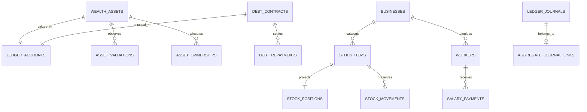

# Database design and executable schema history

Product authority: [ADR 0003](decisions/0003-confirmed-product-architecture.md).
INR, shared family editing, shared documents and both backup destinations are
confirmed. ADR 0004 authorizes additive implementation; the review-only SQL below
is distinct from executable Drift migrations.

`design/postgresql.sql` is an isolated review schema with **deny-all RLS**, no
client write grants, draft integrity/provenance/audit guards and no usable read
policies or mutation RPCs. Do not deploy it or put it in `supabase/migrations/`.
`design/sqlite.sql` preserves the implemented Drift v1 metadata baseline.
`design/sqlite-next.sql` is a future projection design tested only in scratch
memory after v1. It does not modify the application's version or schema snapshot.

## ER overview

```mermaid
erDiagram
  CURRENCIES ||--o{ FAMILIES : defaults_to
  CURRENCIES ||--o{ ACCOUNTS : denominates
  FAMILIES ||--o{ FAMILY_MEMBERS : contains
  FAMILY_MEMBERS ||--o{ DEVICES : enrolls
  DEVICES ||--o{ DEVICE_SESSIONS : binds
  FAMILIES ||--|| SYNC_CLOCKS : orders
  FAMILIES ||--o{ OPERATION_RECEIPTS : deduplicates
  FAMILIES ||--o{ CHANGE_EVENTS : streams
  FAMILIES ||--o{ AUDIT_EVENTS : records
  FAMILIES ||--o{ BUSINESSES : scopes
  BUSINESSES ||--o{ BUSINESS_GRANTS : separate_policy
  BUSINESSES ||--o{ ACCOUNTS : owns
  FAMILIES ||--o{ ACCOUNTS : owns
  ACCOUNTS ||--o{ JOURNAL_POSTINGS : receives
  JOURNAL_ENTRIES ||--|{ JOURNAL_POSTINGS : contains
  FAMILIES ||--o{ MONTHLY_BUDGETS : plans
  FAMILIES ||--o{ SAVINGS_OBSERVATIONS : tracks
  FAMILIES ||--o{ ASSETS : holds
  ASSETS ||--o| METAL_DETAILS : specializes
  ASSETS ||--o| PROPERTY_DETAILS : specializes
  ASSETS ||--o| INVESTMENT_DETAILS : specializes
  ASSETS ||--o{ ASSET_OWNERSHIPS : allocates
  ASSETS ||--o{ ASSET_VALUATIONS : values
  FAMILIES ||--o{ LIABILITIES : records
  LIABILITIES ||--o{ REPAYMENT_SCHEDULES : schedules
  LIABILITIES ||--o{ REPAYMENTS : settles
  REPAYMENTS }o--|| JOURNAL_ENTRIES : posts
  BUSINESSES ||--o{ STOCK_ITEMS : catalogs
  STOCK_ITEMS ||--o{ STOCK_MOVEMENTS : changes
  BUSINESSES ||--o{ SALARY_RECORDS : records
  SALARY_RECORDS }o--o| JOURNAL_ENTRIES : settles
  FAMILIES ||--o{ DOCUMENTS : shares
  FAMILY_MEMBERS ||--o{ DOCUMENTS : owns_metadata
  DOCUMENTS ||--o{ DOCUMENT_VERSIONS : versions
  DOCUMENT_VERSIONS ||--o{ DOCUMENT_KEY_ENVELOPES : wraps
  DEVICES ||--o{ DOCUMENT_KEY_ENVELOPES : receives
  DOCUMENT_VERSIONS ||--o| UPLOAD_RESERVATIONS : reserves
  DOCUMENT_VERSIONS ||--o{ DOCUMENT_ACCESS_EVENTS : audits_access
  FAMILIES ||--o{ BACKUP_SNAPSHOTS : captures
  FAMILIES ||--o{ BACKUP_DESTINATIONS : configures
  BACKUP_SNAPSHOTS ||--o{ BACKUP_COPY_ATTEMPTS : copied_by
  BACKUP_DESTINATIONS ||--o{ BACKUP_COPY_ATTEMPTS : receives
  BACKUP_DESTINATIONS ||--o{ LOCAL_BACKUP_BINDINGS : local_only
```

Family-scoped relationships use composite FKs. Business/account, repayment/journal,
document/version and snapshot/destination associations cannot cross families.
The cloud alone holds session bindings, clocks, mutation receipts, feed and upload
reservations. Local backup bindings exist only on the device. No identities,
family records, documents or financial data are inserted; INR is reference metadata.

## Types, money and presentation

- Cloud UUID; local validated lowercase UUID TEXT, generated once with CSPRNG UUIDv4.
- Server-controlled integer revisions, UTC instants, separate calendar accounting
  dates; client clocks never determine the conflict winner.
- Mutable aggregate roots retain `created_by`, `updated_by`, creation/update times,
  nullable `deleted_at` and revision. Children inherit actor/revision from their
  parent's atomic aggregate mutation. Actor IDs come from verified server context.
- Catalog seed: `INR`, scale 2, symbol ₹ and `en_IN`. Checks fix that INR definition;
  approved international currencies remain extensible. Family and mandatory currency
  columns default to INR; RPCs explicitly supply the effective currency. Optional
  purchase/making currency remains nullable only together with its amount.
- Generic `amount_minor` means paise for INR, each future currency's own minor units
  otherwise. Never reinterpret stored values when a default/catalog changes. Unit
  metadata for any used future currency must also remain stable/versioned.
- Monetary `bigint`/SQLite INTEGER is signed 64-bit. Check overflow, use exact integer
  or rational calculations with reviewed rounding, and never route financial input,
  arithmetic or exact formatting through floating point. Indian digit grouping and
  lakh/crore labels are presentation; exact values remain available (ADR 0003).
- PostgreSQL assignment can round a numeric literal into bigint; SQLite can perform
  lossless affinity coercion. Types alone do not validate a financial API input.
  Reject fractional/floating/boolean/out-of-range/mismatched-unit input **before**
  casts. Future SQLite `STRICT` tables reject REAL monetary storage; this does not
  replace typed input validation. Existing v1 metadata has no monetary columns.
- Metal weight uses integer milligrams, purity parts per million; ownership basis
  points and investment integer quantities/scales are still precision proposals.
- Never store Aadhaar/PAN numbers or document bytes as plaintext search fields.
  Sensitive document metadata and local indexes stay within the encryption boundary.

## Shared identity, documents and audit

Only `administrator`/`member` roles are in the current family scope. Creator,
record ID and family ID are immutable on provenance-bearing records. Every member
may modify another member's shared record with a distinct `updated_by`; ownership
is not an edit gate. Financial deletes retain soft tombstones and prior audit.
Historical member rows remain for provenance after revocation, not as active grants.

`documents.owner_user_id` identifies whose document it is; `created_by` identifies
who uploaded it. No per-document ACL table remains. Every authorized member can
read/upload shared versions. Envelopes remain recipient-device-specific: the key
version PK and active-envelope unique index preserve revoked key history and one
current envelope per version/device. Enrollment requires historical key backfill.
The server must enforce actual key coverage; row existence cannot prove valid crypto.

Append-only audit/access-event guards reject UPDATE/DELETE (and cloud TRUNCATE).
The authenticated gateway records access start and terminal transfer outcome;
offline cached opens are marked device reports. Audit keeps IDs/time/action, never
identity numbers, document contents or operational payload dumps. A compromised
client's local audit copy is not proof of the authoritative server history. Superuser
DDL access can disable guards; operational privilege controls remain required.

Device state and bound sessions are distinct from family identity. FKs prevent
cross-family approvers and actor/device mismatch; they do not prove possession,
administrator approval, active membership or current expiry. Read/write/key/download
boundaries must check those server-side. See [permissions](permissions.md).

## Independent backup catalog

`backup_snapshots` records artifact format/schema, manifest/hash/size, producer
verification time, watermark/epoch and inclusion of pending operations. A complete
artifact may contain explicitly labelled pending work, never missing attachments
or unverified archive bytes. `backup_destinations` has local/Google Drive kinds.
`backup_copy_attempts` has separate status/evidence for each target/retry, requires
a complete snapshot and matches its observed hash/size to that snapshot. Verified
state needs target acknowledgement, receipt and verification/completion timestamps.
A successful local copy does not imply a successful Drive copy.

These checks constrain metadata; trusted adapters must actually verify bytes and
archive authentication. No Drive token/account identity, local filesystem path or
sole recovery key enters the shared catalog. `local_backup_bindings` holds private
device locators and OS secure-store references. Complete recovery and provider
integration remain unimplemented; see [backup/recovery](backup-recovery.md).

## Financial modeling decisions for review

A journal and postings are proposed so a bank/cash transfer is one balanced
aggregate, rather than two unrelated income/expense records. Accounts distinguish
bank/cash and accounting categories. A posted journal balances independently per
currency and business/family scope; posted entries become immutable and corrections
reference reversals. Account totals are derived, never independently authoritative.
Simple income/expense UI can map to this model after the chart/accounting review.

Monthly budgets reference an account/category and a currency. Savings observations
are explicit dated records; automatic savings formulas and target workflows are
not inferred. Valuations retain source/date/currency and never silently replace
purchase cost. Current value means the latest authorized eligible observation,
with a visible as-of date and missing-value state. Asset ownership aggregation
must avoid counting the same family asset once for every owner.

Liabilities distinguish borrowed from lent, original principal, currency and
versioned terms. Interest method/day-count/rounding are intentionally unspecified
until review. Schedules and actual repayments are separate; repayments link to a
journal aggregate, principal and interest components. Do not implement balance
formulas or EMI logic from these placeholders alone.

Business income/purchases/expenses flow through scoped journal entries; salaries
and stock movements retain history. Costing method and cash-vs-accrual P&L remain
open. There are no billing, tax or invoice tables. Vehicles and other valuables
use the common asset model with reviewed extension data later.

## Invariants still requiring trusted server implementation

The SQL supplies tenant/actor FKs, uniqueness, field/time/state checks and draft
identity/audit immutability guards. These are not a complete production backend:

1. Balanced posted journals, at least two postings, allowed scope/account currency,
   immutable posted facts and linked corrections by any authorized member.
2. Ownership total at most 100%, approved precision and historical ownership rules.
3. Concurrent liability repayments, approved interest/EMI/rounding/overpayment rules.
4. Stock/cost rules, negative-stock policy and salary settlement/accounting basis.
5. Actual document encryption/key coverage, immutable finalized content, storage
   verification, authenticated download and read-completion audit.
6. Current family/enrolled-session checks, verified actor stamping, immutable audit
   in the same mutation, administrator-only control operations and last-admin safety.
7. Receipt canonical digest/replay binding, family-clock ordering, authorization
   epoch/snapshot rebuild, tombstone/receipt retention and aggregate atomicity.
8. Genuine archive/provider verification, safe destination transitions/retention,
   current-role restore and full clean-device recovery from each destination.

No direct client DML is allowed. Soft deletion is a mandatory financial behavior;
controlled hard purge remains a separately reviewed administrator procedure. Auth
user deletion must not cascade-delete shared provenance. See the comprehensive
[constraint and authorization review](database-constraint-review.md).

## Future SQLite mapping and current migration boundary

`sqlite-next.sql` explicitly projects the domain, member/device, authorized audit
and backup tables. It excludes server-only `device_sessions`, `sync_clocks`,
`operation_receipts`, `change_events` and `upload_reservations`; the v1 outbox and
checkpoints remain the local receipt/cursor baseline. Never replicate other
families or other devices' key envelopes. The future design is not applied by Flutter.

Mapping: UUID → validated TEXT; bigint → INTEGER; timestamptz → Unix-microsecond
INTEGER; date → validated ISO calendar TEXT; boolean → constrained 0/1 INTEGER;
bytea → BLOB. Monetary data stays relational/exact. New projected tables are STRICT;
the existing v1 metadata baseline is unchanged. Any adoption needs an explicit
reviewed version bump, generated Drift changes and prior-version migration tests.

## Local schema and migration strategy

Phase 3 Drift schema version 1 contains only `pending_mutations`, `sync_checkpoints`
and `sync_conflicts`. The database is not opened by the shell and receives no
financial records. It is scoped and encrypted by a caller with a valid vault key.
Pending payloads/conflict snapshots can contain sensitive content in later phases,
so they must remain in the encrypted database, never logs.

Future local tables mirror only authorized cloud rows plus local sync status and
base revision; local-only attachments store opaque private paths and transfer
state. Relationships and outbox insertion happen in a Drift transaction. A pull
applies rows/tombstones and cursor atomically. Conflict snapshots keep both sides.

Keep versioned Drift schema exports/generated migration helpers and test each
supported upgrade with synthetic prior-version fixtures once a released schema
changes. PostgreSQL migrations are append-only, forward-compatible during rolling
mobile upgrades and tested locally before deployment. Reject unsupported protocol
versions; no destructive fallback. No production SQL is run in initialization.

## Executable local schema update

Drift v2 now adds family/device metadata, accounts, balanced immutable journal
aggregates and postings, budgets, reconciliation, preferences and append-only
local audit. `lib/core/database/finance_tables.dart`, `ledger_guards.dart` and the
versioned snapshot are authoritative for this implemented local version. Historical
v1 tables/snapshot remain intact. The separate proposed future schemas are not
silently substituted for these migrations. See ADR 0005 and the development test
journal for encrypted populated-v1 upgrade and ledger behavior evidence.

## Executable local schema, v3

The application now uses 28 Drift tables, not the future proposal count above.
Version 1 sync metadata and version 2 accounting are preserved. Version 3 adds
wealth_assets, property_details, metal_details, investment_details,
asset_ownerships, asset_valuations, debt_contracts, debt_repayments, businesses,
stock_items, stock_movements, stock_positions, workers, salary_payments and
aggregate_journal_links. See ADR 0008 and the committed v3 schema snapshot.

All module associations are family scoped. Strict integer constraints and triggers
supplement typed exact input/calculation checks. New event tables are append-only;
root edits require the next revision and retain creator identity. Application
service atomicity, backend authorization and realistic multi-client synchronization
require their own implementation/tests; these are not proven by the diagram.
